# Kotak Telegram Trading System

A Python based signal pipeline that reads trading messages from Telegram, converts them into structured events with Google Gemini, and executes those events through Kotak Neo using Apache Kafka as the handoff between services.

> **Live trading warning:** Starting the consumer authenticates to Kotak Neo and can place, modify, or cancel real orders. There is no dry run switch. Verify the account, monitored chats, order product, sizing, and broker environment before starting it.

## Contents

- [System at a glance](#system-at-a-glance)
- [Architecture](#architecture)
- [Signal and order lifecycle](#signal-and-order-lifecycle)
- [Repository map](#repository-map)
- [Requirements](#requirements)
- [Setup](#setup)
- [Run the applications](#run-the-applications)
- [Configuration reference](#configuration-reference)
- [Run with PM2](#run-with-pm2)
- [Deploy across machines and accounts](#deploy-across-machines-and-accounts)
- [Operations and troubleshooting](#operations-and-troubleshooting)
- [Security](#security)

## System at a glance

```mermaid
flowchart LR
    TG[Telegram chats] -->|new message| TL[Producer: Telethon listener]
    TL --> GP[Gemini parser]
    GP -->|actionable ParsedSignal| KP[Kafka producer]
    KP -->|JSON event, contract key| K[(Kafka topic)]
    K -->|one copy per consumer group| KC[Consumer: Kafka reader]
    KC --> OM[Order manager]
    OM -->|search contract, place/manage order| KN[Kotak Neo API]
    KN --> OM
```



The producer and consumer are separate applications with separate Python environments and `.env` files. They communicate only through Kafka, so they can run on one host or on different hosts. Kafka must be reachable from both.

| Component | Responsibility | Main implementation |
| --- | --- | --- |
| Telegram listener | Connects to Telegram, filters incoming chats, keeps a short in-memory message history | `producer/src/telegram_listener.py` |
| Gemini parser | Turns message text and recent context into a typed signal | `producer/src/gemini_parser.py`, `producer/src/models.py` |
| Signal dispatcher | Sends an actionable parsed signal to registered handlers | `producer/src/signal_dispatcher.py` |
| Kafka producer | Serializes a signal as JSON and publishes it to the shared topic | `producer/src/kafka/producer.py` |
| Kafka consumer | Reads events as a configured consumer group and reconstructs the signal | `consumer/src/kafka/consumer.py` |
| Order manager | Resolves signal intent into contract, quantity, price, and order lifecycle actions | `consumer/src/order_manager.py` |
| Kotak client | Authenticates, looks up contracts, and calls Kotak Neo order APIs | `consumer/src/kotak_client.py` |
| PM2 runner | Starts and monitors producer and/or consumer processes | `runner.sh`, `ecosystem.config.cjs` |

## Architecture

### Process boundaries

**Producer (`producer/`)** runs an asynchronous Telethon client. For every non-empty message in the configured chats, it asks Gemini to classify and extract the trading details. Non-trading messages are ignored. Actionable signals are sent to Kafka; the producer does not connect to Kotak or place orders.

**Kafka** is the durable message boundary between ingestion and execution. The default topic is `kotak_trading_signals`. Events are JSON and keyed by a contract identifier such as `NIFTY_22500_CE`. The key keeps events for one contract in the same Kafka partition, preserving their partition order. The producer requests `acks=all` and enables idempotence.

**Consumer (`consumer/`)** is an account-scoped worker. On startup it authenticates to Kotak Neo, subscribes to the topic using its Kafka consumer group, and passes each event to an `OrderManager`. Each account that must receive every signal needs a distinct group ID. Workers in the same group divide partitions and messages between themselves.

### Signal event shape

A published event contains the `ParsedSignal` fields and a `_meta` object. Important signal fields include:

- `is_trading_signal` and `signal_type` (`NEW_ORDER`, `MODIFY_ORDER`, `CANCEL_ORDER`, `IGNORE_SIGNAL`, `CLOSE_POSITION`, or `NONE`)
- `action`, `index`, `strike_price`, and `option_type`
- `order_condition`, `entry_price`, `trigger_price`, `stop_loss`, and `target`
- `reasoning`, `raw_message`, and UTC `timestamp`
- `_meta.event_id`, `_meta.published_at`, and `_meta.source`

Gemini output is parsed into a Pydantic model. If parsing fails, the parser returns a non-actionable `NONE` signal, which is not published. When a trading signal has a strike but no option type, the parser defaults it to `CE`.

### Important delivery behavior

The consumer uses manual Kafka commits and commits after order processing. Its error handler also commits a message after a processing exception to prevent the same malformed or failing event from blocking the partition. This means an order/API failure can result in an event being skipped; inspect consumer logs and Kotak order status when execution fails. The application does not provide a separate persistent order database or automatic reconciliation service.

## Signal and order lifecycle

1. A Telegram `NewMessage` event arrives. Empty message bodies are skipped. If `TELEGRAM_CHANNELS` is populated, only resolved chat IDs are processed.
2. The listener passes the message and recent message history to Gemini. The history is in-memory and bounded; it is not restored after restart.
3. Gemini returns structured JSON; the parser validates/converts it to a `ParsedSignal`. Only signals marked as actionable are dispatched.
4. Kafka publishes the signal, keyed by `contract_key()` and annotated with an event ID and publish time.
5. Each consumer group receives its own stream. A consumer reconstructs the signal model and calls its account's `OrderManager`.
6. For a new order, the order manager resolves the exact live contract and lot size through Kotak Neo. It selects the nearest active expiry unless the signal specifies an expiry, calculates price/order type and quantity, and submits the order.
7. The order manager tracks pending orders in memory and handles supported revise/cancel/close signals against tracked orders. Pending state is lost when that consumer process restarts; it is not an exchange-side order ledger.
8. The consumer commits the Kafka offset after processing (including the error path noted above).

Order conditions map to order styles in the manager: `ABOVE` and `BELOW` create stop-limit orders with a configurable buffer; `AT` and `LIMIT` create limit orders; `MARKET` creates a market order. Risk-based sizing is used only when both a risk percentage and a stop loss are available. Otherwise the configured lot count is used. If risk sizing needs capital and no `DEFAULT_CAPITAL` is set, the consumer queries available funds from Kotak.

## Repository map

```text
.
├── producer/
│   ├── main.py                 # Producer CLI and async process entry point
│   ├── config/settings.py      # Reads producer/.env
│   ├── src/
│   │   ├── telegram_listener.py
│   │   ├── gemini_parser.py
│   │   ├── signal_dispatcher.py
│   │   ├── models.py
│   │   └── kafka/producer.py
│   ├── tests/
│   ├── requirements.txt
│   └── .env.example
├── consumer/
│   ├── main.py                 # Consumer CLI and async process entry point
│   ├── config/settings.py      # Reads consumer/.env
│   ├── src/
│   │   ├── order_manager.py
│   │   ├── kotak_client.py
│   │   ├── models.py
│   │   └── kafka/consumer.py
│   ├── tests/
│   ├── requirements.txt
│   └── .env.example
├── ecosystem.config.cjs        # PM2 process definitions
├── runner.sh                   # Setup and PM2 command wrapper (Bash)
└── README.md
```

The local `.env` files and Telethon `.session` files are ignored by Git. Keep secrets out of `.env.example` files.

## Requirements

- Python 3.10 or newer.
- Apache Kafka, locally or as a reachable broker. Docker is one way to run Kafka locally.
- Telegram API ID/hash and a Telegram account with access to the desired chats.
- Google Gemini API key.
- Kotak Neo API credentials for the account that will execute orders.
- Node.js/npm and PM2 only if you want the included background process runner.
- Bash for `runner.sh`. The script is for Linux/macOS or a Bash environment such as WSL/Git Bash; its virtual environment paths are Unix-style. On native Windows, use the manual commands below with Windows activation (`.venv\\Scripts\\Activate.ps1`) or run through WSL.

Install producer and consumer requirements into separate virtual environments.

## Setup

### 1. Start Kafka

For a local development broker using Docker:

```bash
docker run -d --name trading-kafka -p 9092:9092 apache/kafka:4.1.2
```

If the container already exists, start it with `docker start trading-kafka`. Check it with:

```bash
docker ps --filter name=trading-kafka
docker logs -f trading-kafka
```

The default broker address is `localhost:9092`. The default topic is `kotak_trading_signals`. Kafka may create the topic automatically when enabled; otherwise create it with your broker administration tooling. For a remote broker, set a reachable broker address in both applications and configure Kafka's advertised listeners and security appropriately.

### 2. Set up the producer

Linux/macOS/WSL, from the repository root:

```bash
cd producer
python3 -m venv .venv
source .venv/bin/activate
python -m pip install -r requirements.txt
cp .env.example .env
```

Native Windows PowerShell:

```powershell
cd producer
py -m venv .venv
.\.venv\Scripts\Activate.ps1
python -m pip install -r requirements.txt
Copy-Item .env.example .env
```

Edit `producer/.env`. At minimum set `TELEGRAM_API_ID`, `TELEGRAM_API_HASH`, `TELEGRAM_PHONE`, `TELEGRAM_CHANNELS`, and `GEMINI_API_KEY`. Get Telegram API credentials from [my.telegram.org](https://my.telegram.org/). Chat entries can be usernames, invite links, or numeric chat IDs, separated by commas.

Sign in once from the `producer/` directory with the virtual environment active:

```bash
python main.py --login-telegram
```

Complete Telegram verification. The command prints available groups/channels to help identify chat IDs. It stores a `.session` file under `producer/`; protect it like a password. You do not need to repeat login unless the session is revoked or expires.

Optionally check Gemini parsing without publishing an event:

```bash
python main.py --test-signal "buy nifty 22500 above 50"
```

This calls Gemini and may incur API usage. It does not publish to Kafka or place an order.

### 3. Set up the consumer

Linux/macOS/WSL:

```bash
cd consumer
python3 -m venv .venv
source .venv/bin/activate
python -m pip install -r requirements.txt
cp .env.example .env
```

Native Windows PowerShell:

```powershell
cd consumer
py -m venv .venv
.\.venv\Scripts\Activate.ps1
python -m pip install -r requirements.txt
Copy-Item .env.example .env
```

Edit `consumer/.env` with the Kotak credentials (`KOTAK_CONSUMER_KEY`, `KOTAK_MOBILE_NUMBER`, `KOTAK_UCC`, `KOTAK_TOTP_KEY`, and `KOTAK_MPIN`). Confirm the `KOTAK_ENVIRONMENT` value with the API/account setup. Make sure the consumer's Kafka broker and topic match the producer.

Review `DEFAULT_PRODUCT_TYPE`, `DEFAULT_LOTS`, `RISK_PERCENTAGE`, and `DEFAULT_CAPITAL` before starting. The sample product is `MIS` and lot count is `1`. See [Configuration reference](#configuration-reference) for all options.

## Run the applications

Keep Kafka running before starting the services. The producer and consumer can run in separate terminals.

### Start producer

From `producer/` with its environment activated:

```bash
python main.py
```

It connects to Telegram and Kafka and stays active until interrupted. It logs chat resolution, incoming messages, Gemini results, and Kafka publish offsets. Keep `TELEGRAM_CHANNELS` limited to intended sources. If it is empty, the listener handles all incoming channel messages available to that Telegram account.

Producer options:

```text
--login-telegram       Sign in and create the Telegram session
--test-signal TEXT     Parse one message without publishing
--kafka-servers ADDR   Override KAFKA_BOOTSTRAP_SERVERS
--kafka-topic NAME     Override KAFKA_TOPIC_SIGNALS
```

### Start consumer

From `consumer/` with its environment activated:

```bash
python main.py --account-id acc_main --group-id kotak_executor_acc_main
```

The consumer authenticates to Kotak during startup. It will fail to start if the credentials are incomplete, the Kotak authentication fails, or required dependencies are unavailable. Once connected, actionable topic events can result in live order actions.

Consumer options:

| Option | Purpose |
| --- | --- |
| `--account-id ID` | Account label used in logs; defaults to `default`. |
| `--group-id NAME` | Kafka group ID. Use a unique value for each account that must get every signal. |
| `--kafka-servers ADDR` | Override `KAFKA_BOOTSTRAP_SERVERS`. |
| `--kafka-topic NAME` | Override `KAFKA_TOPIC_SIGNALS`. |
| `--lots N` | Override default lot count. |
| `--product MIS\|NRML` | Override product type. |
| `--risk-percent PERCENT` | Override risk percentage. |
| `--capital AMOUNT` | Override capital used by risk sizing. |

See the complete CLI usage with `python main.py --help` in the corresponding application directory.

## Configuration reference

Each application loads its own `.env` from its project directory. Environment variables already set in the process may also supply values. Defaults below reflect the checked-in templates and settings.

### Producer (`producer/.env`)

| Variable | Purpose | Default |
| --- | --- | --- |
| `TELEGRAM_API_ID`, `TELEGRAM_API_HASH` | Telegram application credentials | empty / `0` |
| `TELEGRAM_PHONE` | Phone used for Telegram sign-in | empty |
| `TELEGRAM_SESSION_NAME` | Session filename stem | `kotak_trader_session` |
| `TELEGRAM_CHANNELS` | Comma-separated chat IDs, usernames, or links | template: `@your_signals_channel`; empty means all incoming channel messages |
| `GEMINI_API_KEY` | Gemini API credential | empty |
| `GEMINI_MODEL` | Model name used by Gemini | `gemini-3.8-flash` in template/settings |
| `GEMINI_TEMPERATURE` | Parsing generation temperature | `0.1` |
| `GEMINI_TIMEOUT_SECONDS` | Configured parser timeout value | `30` |
| `MESSAGE_HISTORY_CONTEXT_SIZE` | Number of recent messages supplied as context | `5` |
| `KAFKA_BOOTSTRAP_SERVERS` | Kafka bootstrap address(es) | `localhost:9092` |
| `KAFKA_TOPIC_SIGNALS` | Shared signal topic | `kotak_trading_signals` |
| `KAFKA_SECURITY_PROTOCOL` | Kafka protocol | `PLAINTEXT` |
| `KAFKA_SASL_MECHANISM`, `KAFKA_SASL_USERNAME`, `KAFKA_SASL_PASSWORD` | Optional Kafka SASL auth | unset |

### Consumer (`consumer/.env`)

| Variable | Purpose | Default |
| --- | --- | --- |
| `KOTAK_CONSUMER_KEY` | Kotak Neo API consumer key | empty |
| `KOTAK_MOBILE_NUMBER` | Registered account phone | empty |
| `KOTAK_UCC` | Unique client code | empty |
| `KOTAK_TOTP_KEY` | Base32 TOTP secret for API login | empty |
| `KOTAK_MPIN` | Kotak Neo MPIN | empty |
| `KOTAK_ENVIRONMENT` | Kotak API environment | `prod` |
| `DEFAULT_PRODUCT_TYPE` | Default product | `MIS` |
| `DEFAULT_LOTS` | Fallback number of lots | `1` |
| `SL_LIMIT_BUFFER_PERCENT` | Limit-price buffer for stop-limit orders | `1.0` percent |
| `AUTO_CANCEL_ON_REVISE` | Whether a revision cancels the existing pending order | `true` |
| `RISK_PERCENTAGE` | Risk fraction expressed as a percentage | unset |
| `DEFAULT_CAPITAL` | Capital for risk-based sizing, INR | unset; live funds are requested if required |
| `KAFKA_BOOTSTRAP_SERVERS` | Kafka bootstrap address(es) | `localhost:9092` |
| `KAFKA_TOPIC_SIGNALS` | Shared signal topic; must match producer | `kotak_trading_signals` |
| `KAFKA_CONSUMER_GROUP_ID` | Default consumer group ID | `kotak_executor_default` |
| `KAFKA_AUTO_OFFSET_RESET` | Initial offset policy for a new group | `latest` |
| `KAFKA_SECURITY_PROTOCOL` | Kafka protocol | `PLAINTEXT` |
| `KAFKA_SASL_MECHANISM`, `KAFKA_SASL_USERNAME`, `KAFKA_SASL_PASSWORD` | Optional Kafka SASL auth | unset |

`--group-id` takes precedence over `KAFKA_CONSUMER_GROUP_ID`. CLI options for product, lots, risk percentage, and capital override their configuration defaults for that run.

## Run with PM2

`runner.sh` is a Bash script that provisions both Python environments and manages processes through PM2. Kafka remains a separately managed service. Install Node.js/npm and PM2 first:

```bash
npm install -g pm2
```

From the repository root, on Linux/macOS/WSL:

```bash
chmod +x runner.sh
./runner.sh setup
```

Edit both `.env` files, then create the Telegram session:

```bash
./runner.sh login-telegram
```

Start both services (and Kafka separately beforehand):

```bash
./runner.sh start acc_main kotak_executor_acc_main
```

The runner checks required credentials and the Telegram session file before it starts processes. It starts/restarts entries from `ecosystem.config.cjs` and saves the PM2 process list.

| Command | Action |
| --- | --- |
| `./runner.sh setup` | Create both virtual environments, install requirements, and copy missing `.env` files. |
| `./runner.sh setup-producer` | Set up only producer. |
| `./runner.sh setup-consumer` | Set up only consumer. |
| `./runner.sh login-telegram` | Sign into Telegram interactively. |
| `./runner.sh start [ACCOUNT] [GROUP]` | Start/restart producer and consumer. |
| `./runner.sh start-producer` | Start/restart only producer. |
| `./runner.sh start-consumer [ACCOUNT] [GROUP]` | Start/restart only consumer. |
| `./runner.sh setup-start [ACCOUNT] [GROUP]` | Set up both projects, then try to start both. |
| `./runner.sh status` | Show PM2 process status. |
| `./runner.sh logs [producer\|consumer]` | Follow both logs or one service's logs. |
| `./runner.sh stop` | Stop both processes. |
| `./runner.sh restart [ACCOUNT] [GROUP]` | Start/restart both services. |
| `./runner.sh delete` | Stop and remove both PM2 entries. |

For PM2 startup after machine reboot, run `pm2 startup`, execute the command it prints, then run `pm2 save`. Use `./runner.sh stop` before intentionally stopping the applications or their broker.

## Deploy across machines and accounts

The producer host and consumer host both connect to Kafka. Set `KAFKA_BOOTSTRAP_SERVERS` to a network address each host can reach; `localhost` only works when Kafka runs on that same host. Configure Kafka `advertised.listeners` to return reachable broker addresses and restrict firewall access. See the [Kafka broker configuration](https://kafka.apache.org/41/configuration/broker-configs/) reference.

To add a consumer on another Linux/WSL VM:

```bash
git clone https://github.com/pawanbudati/neo-telegram-trading-system.git
cd neo-telegram-trading-system
npm install -g pm2
chmod +x runner.sh
./runner.sh setup-consumer
```

Fill in that VM's `consumer/.env` with its account credentials and the Kafka VM's reachable private address, for example `10.0.0.12:9092`. Then start only the consumer:

```bash
./runner.sh start-consumer acc_secondary kotak_executor_acc_secondary
./runner.sh status
./runner.sh logs consumer
```

Repeat per account, using the proper Kotak credentials and a distinct group ID. Different consumer groups each receive every retained event. Consumers sharing a group split the work. With the default `latest` policy, a new group starts with messages published after it joins; use `earliest` if a new group should consume retained earlier events.

## Operations and troubleshooting

- **Producer says channel resolution failed:** Check Telegram account membership and the exact `TELEGRAM_CHANNELS` username, invite link, or ID. The listener logs failures and continues with successfully resolved chats.
- **Telegram authorization is missing:** Run `python main.py --login-telegram` from `producer/` or `./runner.sh login-telegram`, then verify that the configured session file exists.
- **No Kafka connection:** Confirm the broker is running, the address is reachable from that process, the topic exists if auto-creation is disabled, and protocol/SASL settings match.
- **Consumer does not see older events:** A new group defaults to `latest`; set `KAFKA_AUTO_OFFSET_RESET=earliest` for a brand-new group that should read retained events.
- **Consumer cannot authenticate to Kotak:** Check all five Kotak credential values, system time (TOTP depends on it), environment, and the API response in consumer logs.
- **Contract lookup fails:** Verify the signal's index/strike/option type and that Kotak returns a currently active expiry. The client deliberately refuses to guess a symbol.
- **Order is not placed or modified:** Review the consumer's execution result and Kotak order status. Kafka messages are committed even on processing errors, so a failure will not automatically retry the event.
- **Process status/logs:** Use `./runner.sh status`, `./runner.sh logs producer`, and `./runner.sh logs consumer`; PM2 logs are managed separately from the application source.

## Security

- The consumer is a live trading executor and has no dry-run mode. Start it only after checking all account and order settings.
- Keep `TELEGRAM_CHANNELS` restricted to intended chats; an empty value monitors all incoming channel messages the signed-in account can receive.
- Never commit `.env`, `.session` files, API keys, MPINs, TOTP secrets, or broker credentials.
- Use authenticated/encrypted Kafka connectivity outside a trusted development setup. Do not expose a plaintext broker to the public internet; restrict network access to required hosts.
- The Gemini parser sends message text and recent message context to Google's Gemini API. Ensure this is appropriate for the source chat and your data-handling requirements.
- Active/pending order tracking and Telegram history are in process memory. A process restart clears that local state.
